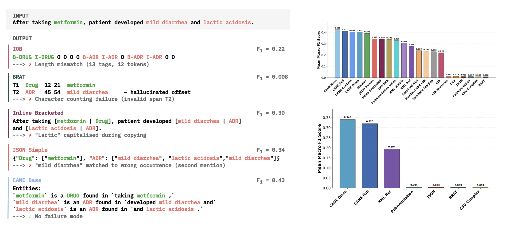

# CANE is a Format: Rethinking Output Formats for Few-Shot LLM-Based Named Entity Recognition

Code for the paper [CANE is a Format](https://aclanthology.org/2026.findings-emnlp.1398/) (Findings of EMNLP 2026).
We evaluate 21 output formats for few-shot NER with open-weight LLMs and propose CANE
(Context-Anchored Natural Expression), a family of four output formats.



## Using CANE in your own work

This repository reproduces the paper's experiments. To use CANE in your own projects, use the
[cane-format](https://github.com/coree/cane-format) library (`pip install cane-format`,
[documentation](https://coree.github.io/cane-format/)): it writes few-shot examples as CANE,
parses model output back into character spans, and converts between CANE and common
annotation formats. The library is developed separately from this code, so its parsing can
differ in details from the paper's implementation; use this repository to reproduce the
paper's numbers.

## Setup

```bash
git clone https://github.com/IDSIA-NLP/CANE
cd CANE
pip install -r requirements.txt   # Python 3.11
```

Create a `.env` file in `src/` with your Hugging Face token:

```
HF_TOKEN=...
```

## Data

- **Simple datasets** (CoNLL-2003, NCBI Disease, BioNLP-2004, WNUT-2017, BC5CDR, FIN, OntoNotes-5, WikiNeural, MultiNERD, WikiANN) are downloaded from Hugging Face automatically.
- **CADEC and GENIA**: download [CADEC](https://data.csiro.au/dap/landingpage?pid=csiro:10948&v=3&d=true)
  (folders `original/` and `text/`) and the [GENIA term annotation](https://www.geniaproject.org/genia-corpus/term-annotation)
  corpus, place them in `data/datasets/original/cadec/` and `data/datasets/original/genia/`, then run from `src/`:
  ```bash
  python prepare_datasets.py --dataset cadec
  python prepare_datasets.py --dataset genia
  ```
- **SHARE-2013-P and SHARE-2014-P** require a [PhysioNet](https://physionet.org/) data use agreement.
  Their few-shot examples are therefore not included in `paper_examples*.json`. Download
  [ShARe/CLEF 2013](https://physionet.org/content/shareclefehealth2013/1.0/) and
  [2014 Task 2](https://physionet.org/content/shareclefehealth2014task2/1.0/) and extract them into
  `data/datasets/original/share2013/` and `.../share2014/` with `train|test/{text,ann}` folders, as in the
  `data/share2013/script.sh` and `data/share2014/script.sh` of
  [Dai et al. (2020)](https://github.com/dainlp/acl2020-transition-discontinuous-ner). We use the official
  test sets. Then run from `src/`:
  ```bash
  python prepare_datasets.py --dataset share2013
  python prepare_datasets.py --dataset share2014
  python chunk_share_datasets_paragraphs.py
  python create_dataset_examples.py   # writes resources/examples.json
  ```
  Copy the `share2013`, `share2014`, `share2013_paragraphs` and `share2014_paragraphs` entries from
  `resources/examples.json` into `resources/paper_examples.json`, replacing the placeholders. 

## Run

Edit `src/config.yml` and run:

```bash
cd src
python run.py
```

The default config runs CANE-Base and CANE-Full with Qwen3-1.7B on CoNLL-2003. Results are written to `data/results_scratch/<timestamp>_results-ner/`: a results table (`*.tsv`) with F1 and error counts per model, dataset and format, plus per-prediction outputs (`*_detailed.jsonl`), the used examples (`*_metadata.json`) and the config.

Scores are computed with [nervaluate-disco](https://github.com/coree/nervaluate-disco/tree/c6369945db5fa139e9459dd7d90c49ee51ad50d5),
our fork of [nervaluate](https://github.com/MantisAI/nervaluate) that supports discontinuous and
overlapping entities (the commit used in the paper, pinned in `requirements.txt`).

## Experiments

Experiments settings in the  `src/config.yml`:

| Experiment | Config |
|---|---|
| Main results | all 9 models, all formats except the ablations, all datasets |
| Token-level ablations | formats `cane_base_abl_*`, `pt_format` |
| Thinking mode | models with `:thinking` |
| Discontinuous demonstrations | `examples_file: paper_examples_disco_ablation.json` |
| Two-shot | `num_examples: 2` |
| No label normalization | `use_semantic_labels: False` |
| No format guidelines | no config option: comment out the `Guidelines:` line in `build_ner_context` in `src/helpers/context_builder.py` |
| Model versions | `Mistral-7B-Instruct-v0.1`, `Qwen2.5-7B-Instruct` |
| Cross-lingual | datasets `unimelb-nlp/wikiann:de/fr/zh` |


## Repository structure

```
src/
├── run.py                        # Runs the experiments defined in config.yml
├── config.yml                    # Models, formats, datasets and settings
├── formatters/                   # Output formats (one formatter per format) and format guidelines
├── parsers/                      # Parsers that turn model output back into entity spans
├── loaders/                      # Dataset and model loaders (vLLM)
├── helpers/                      # Prompt building, prediction, validation, result saving
├── evaluator.py                  # Strict macro F1 (nervaluate-disco)
├── prepare_datasets.py           # Converts CADEC, GENIA and SHARE to BRAT format
├── chunk_share_datasets_paragraphs.py  # Splits SHARE documents into paragraphs (SHARE-2013-P/-2014-P)
└── create_dataset_examples.py    # Builds the few-shot example files
resources/
├── paper_examples.json           # Few-shot examples used in the paper
├── paper_examples_disco_ablation.json  # Examples for the discontinuous-demonstration ablation
└── labels.json                   # Label sets and readable label names per dataset
```

## Citation

```bibtex
@inproceedings{cornelius-etal-2026-cane,
    title = "{CANE} is a Format: Rethinking Output Formats for Few-Shot {LLM}-Based Named Entity Recognition",
    author = "Cornelius, Joseph  and
      Ito, Kei K  and
      Rinaldi, Fabio",
    editor = "Lee, Hung-Yi  and
      Dev, Sunipa  and
      Li, Jessy  and
      Elliott, Desmond",
    booktitle = "Findings of the {A}ssociation for {C}omputational {L}inguistics: {EMNLP} 2026",
    month = oct,
    year = "2026",
    address = "Budapest, Hungary",
    publisher = "Association for Computational Linguistics",
    url = "https://aclanthology.org/2026.findings-emnlp.1398/",
    pages = "29773--29800",
    ISBN = "979-8-89176-462-0",
}
```
